# Product API (CS6650 Homework 5)

For this homework I built the Product part of the online store API from `api.yaml` in Go with Gin. I packaged it with Docker, deployed it to AWS ECS (Fargate) using Terraform, load tested it with Locust, and then added Prometheus metrics, a Grafana dashboard and JSON request logs so I could actually see what the server was doing.

## Where things are

- `src/product-service.go` is the server. The handlers, the in-memory product store, the metrics and the logging are all in this one file.
- `src/Dockerfile` builds the image.
- `terraform/` is the infrastructure. I forked it from the starter repo and adapted it for my server.
- `locust/locustfile.py` has my load tests.
- `docker-compose.yml` and `observability/` are the local Prometheus + Grafana setup. My exported dashboard and the log excerpt are in there too.
- `postman/` has my Postman collection (one request per response code).
- `screenshots/` has every screenshot used in this README.

## How the API works

I implemented the two Product endpoints from the spec:

- `GET /products/{productId}` returns the product with a 200, or a 404 if it doesn't exist.
- `POST /products/{productId}/details` updates a product's details and returns a 204 with no body. Bad input gives a 400 and an unknown product gives a 404.

Both can also return a 500, and every error uses the spec's error format: `{"error": "...", "message": "...", "details": "..."}`.

A few decisions I had to make while reading the spec:

- There's no "create product" endpoint, and the POST can return 404, so I treated POST as "update an existing product". The server starts with products 1 to 100 already loaded.
- The GET endpoint doesn't list a 400, so an invalid ID like `/products/abc` returns a 404, since no product can have that ID.
- Validation follows the Product schema: all six fields are required, the IDs must be at least 1, `weight` must be at least 0, and `sku`/`manufacturer` have length limits. One thing that caught me out: `weight` is allowed to be 0, but in Go a missing number and a 0 look the same, so I made `weight` a pointer to tell them apart. I also return a 400 if the ID in the path doesn't match `product_id` in the body.
- To be able to show a 500, I added a test header. Sending `X-Simulate-Error: true` makes the handler panic, and my recovery middleware turns that into the spec's error JSON instead of an empty response.
- Products are stored in a Go map (fast lookup by ID) protected by a `sync.RWMutex`. Without the lock, concurrent writes to a Go map crash the program. The read/write lock lets lots of GETs run at the same time, and a POST gets the map to itself while it writes.

## Deploying it yourself

This is how someone in my group can deploy everything on their own machine. I used AWS Learner Lab.

You'll need the AWS CLI, Terraform and Docker Desktop installed, and Docker needs to be running (Terraform builds the image locally).

1. Get your Learner Lab credentials: Start Lab, then AWS Details, then Show next to AWS CLI. Paste that block into `~/.aws/credentials` and check it works:
   ```bash
   aws sts get-caller-identity
   ```
2. Clone the repo and deploy:
   ```bash
   git clone https://github.com/archit2901/CS6650_2b_demo.git
   cd CS6650_2b_demo/terraform
   terraform init
   terraform apply
   ```
   Type `yes` when it asks. This builds the image, pushes it to ECR and creates the ECS service. It takes a few minutes.
3. Find the public IP. Fargate only assigns it when the task starts, so Terraform can't print it. Give it about a minute, then run this from the `terraform/` folder:
   ```bash
   REGION=us-east-1
   CLUSTER=$(terraform output -raw ecs_cluster_name)
   SERVICE=$(terraform output -raw ecs_service_name)
   TASK=$(aws ecs list-tasks --cluster $CLUSTER --service-name $SERVICE --region $REGION --query 'taskArns[0]' --output text)
   ENI=$(aws ecs describe-tasks --cluster $CLUSTER --tasks $TASK --region $REGION \
     --query "tasks[0].attachments[0].details[?name=='networkInterfaceId'].value" --output text)
   aws ec2 describe-network-interfaces --network-interface-ids $ENI --region $REGION \
     --query 'NetworkInterfaces[0].Association.PublicIp' --output text
   ```
   If `TASK` comes back as `None`, the task hasn't started yet. Wait a bit and run it again.
4. Try it:
   ```bash
   curl -i http://<PUBLIC_IP>:8080/products/1
   ```
5. When you're done, clean up with `terraform destroy`.

If you're on an Apple Silicon Mac like me, you don't need to do anything special. The Dockerfile already builds for x86, which is what Fargate runs.

### Running it locally

```bash
# Plain Go
cd src && go run product-service.go

# Docker
cd src && docker build -t product-api . && docker run --rm -p 8080:8080 product-api

# App + Prometheus + Grafana (what I used for Part V)
docker compose up -d --build
```

With docker compose, the app is on `localhost:8080`, Prometheus on `localhost:9090` and Grafana on `localhost:3000` (login `admin` / `admin`). To get my dashboard, go to Dashboards, New, Import, and pick `observability/grafana-dashboard.json`.

## Every response code

Set `HOST=http://localhost:8080`, or use `http://<PUBLIC_IP>:8080` for the deployed version.

| Code       | How I trigger it                                                                                                                                                                            |
| ---------- | ------------------------------------------------------------------------------------------------------------------------------------------------------------------------------------------- |
| 200        | `curl -i $HOST/products/1`                                                                                                                                                                  |
| 404 (GET)  | `curl -i $HOST/products/999` for a product that doesn't exist, or `curl -i $HOST/products/abc` for an invalid ID                                                                            |
| 500 (GET)  | `curl -i -H "X-Simulate-Error: true" $HOST/products/1`                                                                                                                                      |
| 204        | `curl -i -X POST $HOST/products/1/details -H "Content-Type: application/json" -d '{"product_id":1,"sku":"NEW-SKU-1","manufacturer":"Globex","category_id":5,"weight":0,"some_other_id":7}'` |
| 400        | The same POST but with a missing field (no `sku`), `"category_id":0`, `"product_id":2` (doesn't match the path), broken JSON, or the path `/products/abc/details`                           |
| 404 (POST) | A valid POST to `/products/999/details` with `"product_id":999`                                                                                                                             |
| 500 (POST) | Any POST with `-H "X-Simulate-Error: true"`                                                                                                                                                 |

I also put all 12 of these requests in a Postman collection (`postman/Product-API.postman_collection.json`). Import it, set the `baseUrl` collection variable, and run the whole thing at once.

Here it is against my Docker container locally, with every code coming back as expected:

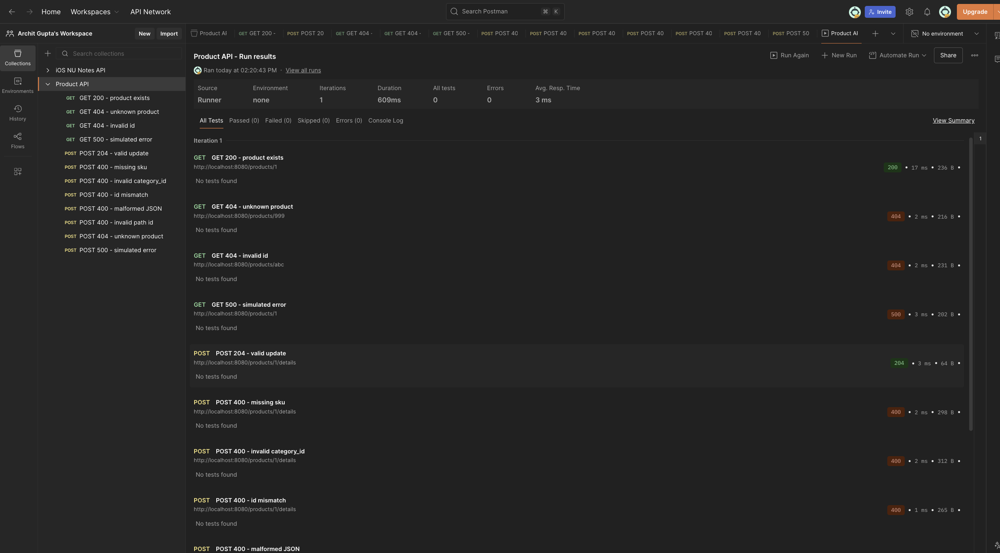

And the same 12 requests against the deployed version on ECS:

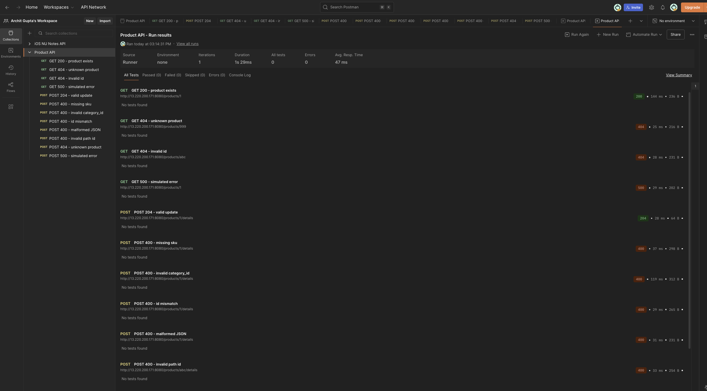

## What I changed from the starter repo

- Replaced the albums server in `src/` with my `product-service.go`, its `go.mod`/`go.sum` and my Dockerfile.
- Added `GOARCH=amd64` and `FROM --platform=linux/amd64` to the Dockerfile. I build on an ARM Mac but Fargate runs x86, and without this the image wouldn't run there. The starter Dockerfile already had the `GOARCH` part, so I followed that.
- Changed the region in `terraform/variables.tf` to `us-east-1`, since I'm on the East Coast.
- Added the Locust, docker-compose, observability, Postman and screenshot folders, and added `.venv/` to `.gitignore`.

## Part IV: Load testing

### How I set up the tests

Each simulated user waits between 0.1 and 0.5 seconds between requests. I used 90% GETs and 10% POSTs, because in a real store people browse products far more often than anyone updates product details. I started small and kept increasing the number of users, so that each test answered one question: does the client library matter, and where does something finally break?

| Test | Client                     | Users | Spawn rate | RPS         | Median | What I saw                                                        |
| ---- | -------------------------- | ----- | ---------- | ----------- | ------ | ----------------------------------------------------------------- |
| 1    | HttpUser                   | 50    | 10/s       | 143         | 35 ms  | Limited by the wait time, nothing else                            |
| 2    | FastHttpUser               | 50    | 10/s       | 143         | 34 ms  | Same as Test 1                                                    |
| 3    | HttpUser                   | 500   | 25/s       | 1,374       | 42 ms  | Server CPU around 70%                                             |
| 4    | FastHttpUser               | 500   | 25/s       | 1,406       | 41 ms  | Almost the same as Test 3                                         |
| 5    | HttpUser, 1 process        | 2,000 | 50/s       | ~3,600      | 200 ms | My Mac's CPU maxed out, and the server was close to its limit too |
| 6    | FastHttpUser, 1 process    | 2,000 | 50/s       | ~5,300 peak |        | About 45% more load than Test 5, but my Mac ran out of ports      |
| 7    | FastHttpUser, 12 processes | 3,000 | 50/s       | ~3,900 max  | 420 ms | My stress test, where the server hit its limit                    |

|        | Statistics              | Charts                  |
| ------ | ----------------------- | ----------------------- |
| Test 1 |   | 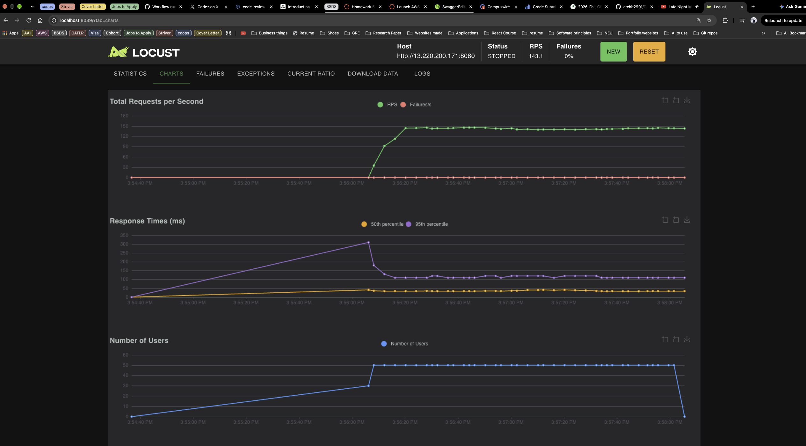  |
| Test 2 |   | 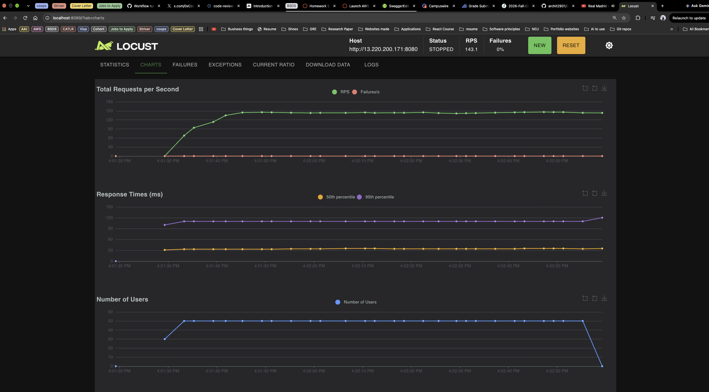  |
| Test 3 |   | 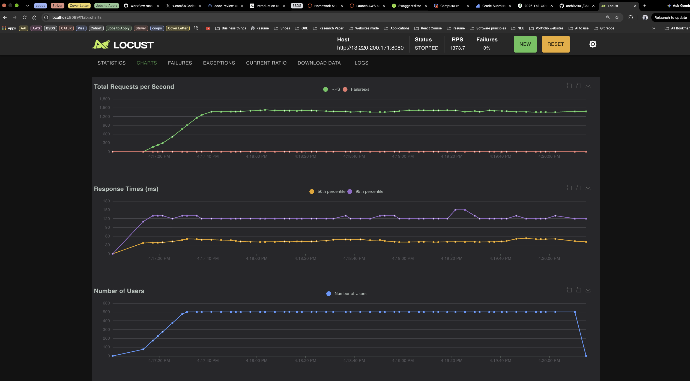  |
| Test 4 | 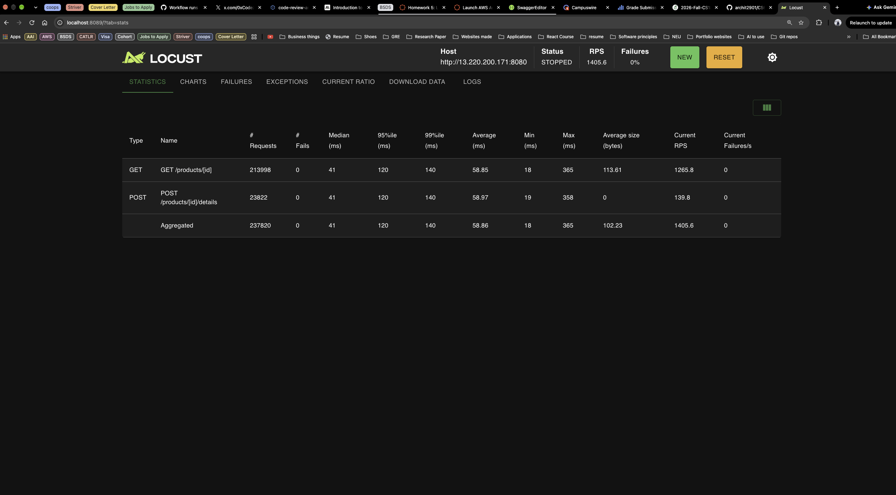  | 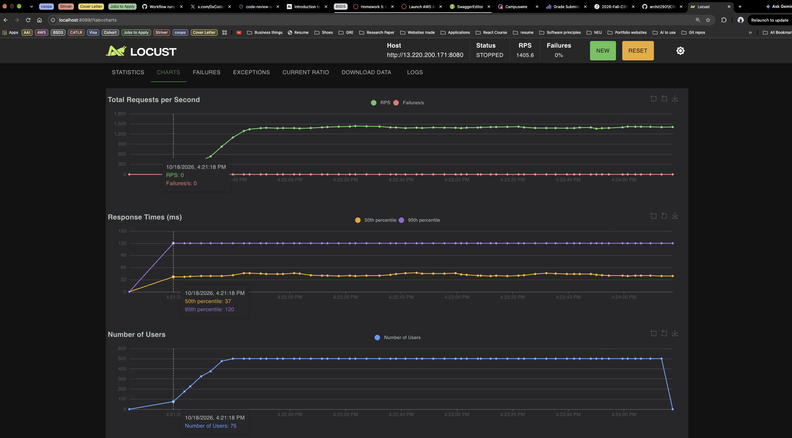 |
| Test 5 | 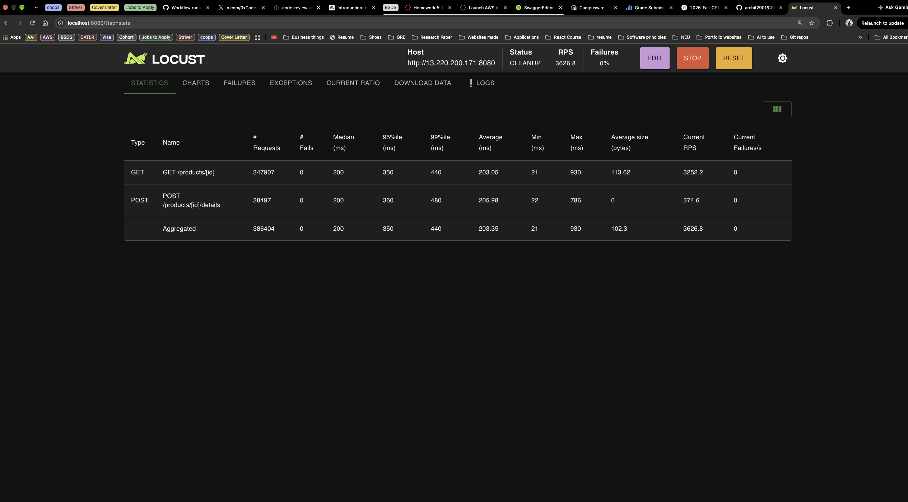 | 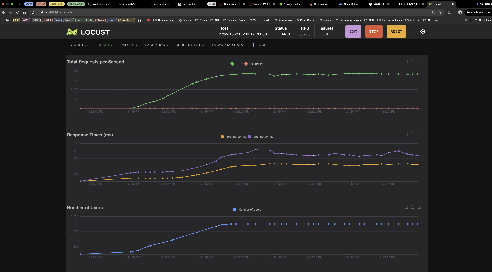 |
| Test 6 | 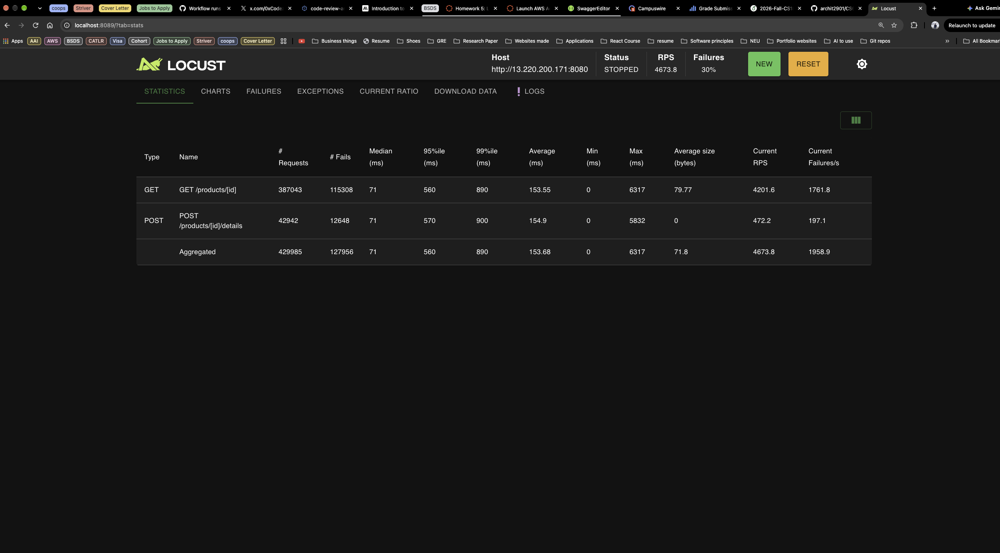 | 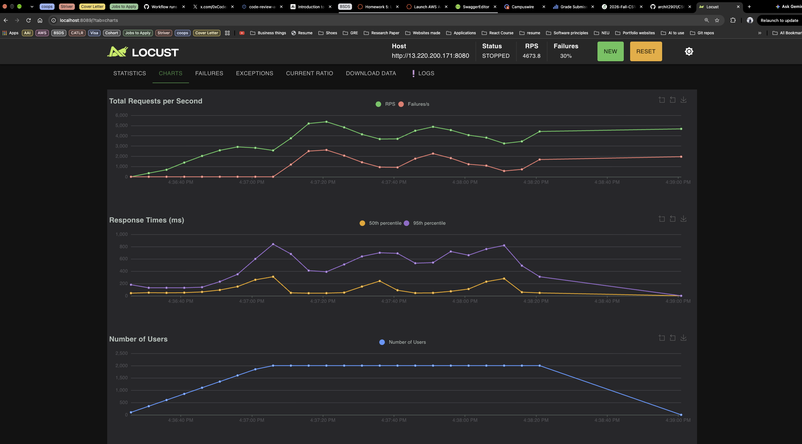 |
| Test 7 | 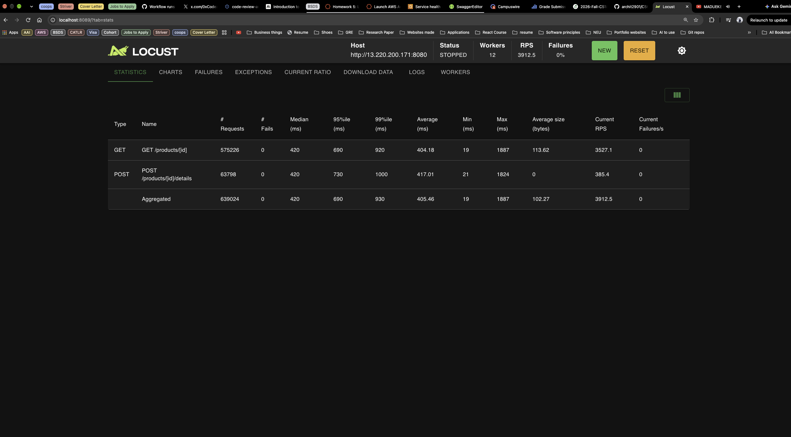 | 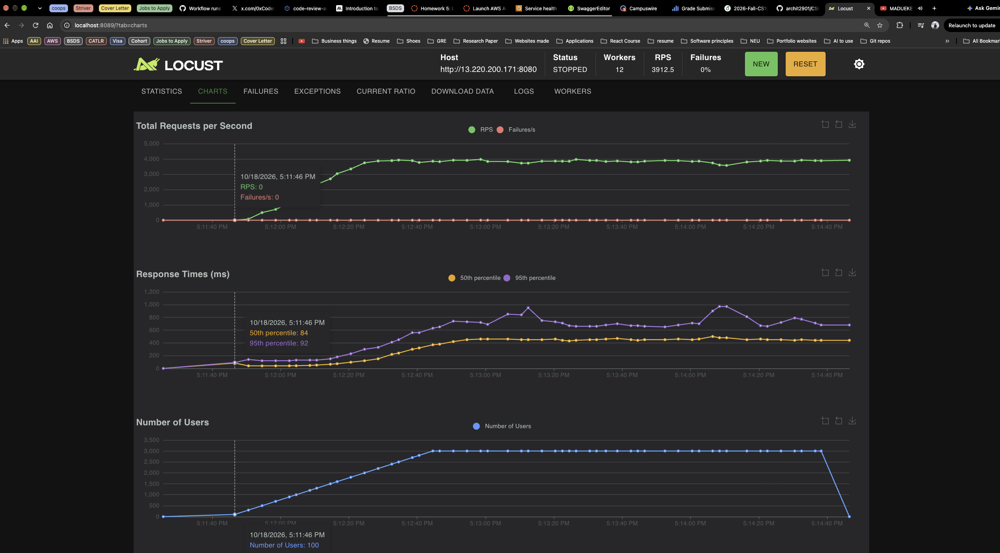 |

The 30% failures in Test 6 were all `OSError 49 "Can't assign requested address"`. That error comes from my Mac running out of local ports for new connections, so those requests never even left my laptop. They weren't server failures. For Test 7 I raised the port limit and spread Locust across all 12 of my CPU cores, so the only thing left to break was the server.

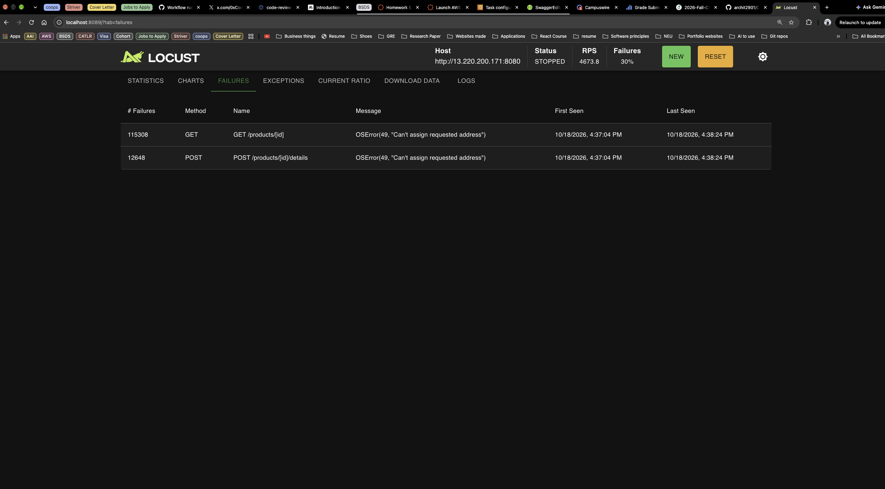

### Where my server started to struggle

In Test 7, throughput stopped at about 3,900 requests per second. Users kept going up to 3,000, but the RPS line went flat and the response times climbed instead (median from about 40 ms to about 420 ms). There were no errors at all. Go kept accepting connections, and requests just waited longer in line.

The ECS graph shows why. CPU hit 100% of the task's 0.25 vCPU during the test, while memory stayed under 25%. So my server is limited by CPU, not memory, which makes sense: storing 100 products takes almost no memory, but handling thousands of requests a second takes a lot of CPU.

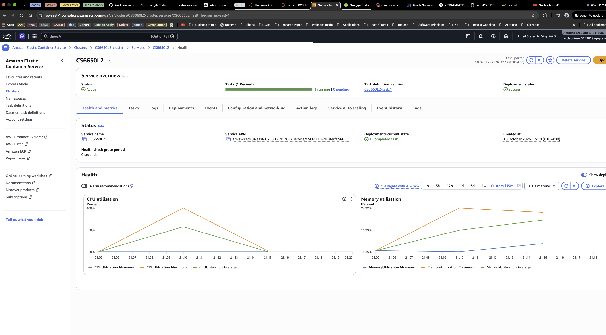

Looking back at Test 5, latency actually started rising around 4:31:35, about 25 seconds before Locust warned that my Mac's CPU was over 90%. So in that test the server started struggling first, and my laptop wasn't far behind.

### HttpUser vs FastHttpUser

At first I didn't see any difference. In Tests 1 to 4 the results were basically identical, because throughput was set by the wait time and most of the response time was just the network trip to AWS. My laptop had plenty of spare CPU, so a faster HTTP client had nothing to speed up.

The difference only showed up once my laptop became the bottleneck. With one Locust process and 2,000 users, HttpUser topped out around 3,600 RPS when the CPU maxed out, while FastHttpUser pushed about 5,300 RPS before hitting the same wall.

From reading about it, the reason is how much work each client does per request. HttpUser is built on the `requests` library, which is pure Python and does a lot of work per request. FastHttpUser uses `geventhttpclient`, which parses HTTP in C and does much less. One Locust process only uses one CPU core, so the cheaper client gets more requests out of the same machine.

### Tradeoffs

Reads are going to be by far the most common operation in a real store, since people look at products much more often than product details change. That fits my data structure well. A map gives a fast lookup by ID, and the read/write lock lets many GETs happen at the same time. If writes were much more common, the single lock would turn into the bottleneck, and I'd look at splitting the map into several smaller maps, each with its own lock.

The biggest thing I learned from this part is to check the load generator before blaming the server. In Tests 5 and 6, my laptop broke before the server did, first on CPU and then on network ports.

## Part V: Observability

I added three things to the server, all in `product-service.go`:

- A `/metrics` endpoint using the Prometheus Go client, with a counter for every request (rate), a counter for non-2xx responses (errors), and a histogram of response times (duration, so I can get p50 and p95).
- One JSON log line per request with the method, endpoint, path, status code and duration, using Go's built-in `log/slog`.
- A middleware that records both of these for every request, including the simulated 500s.

For the metrics I label requests by the route (`/products/:productId`) instead of the real URL. Otherwise every product ID would create its own metric series. The logs do include the exact path, since logs don't have that problem.

Prometheus and Grafana run locally next to the app with docker compose. Prometheus scrapes `/metrics` every 5 seconds.

### Dashboard: idle vs. loaded

This covers 00:25 to 00:45. It starts idle, then my Locust run (500 users, about 1,650 requests per second, 0% errors), then idle again at 0 requests per second, then a burst of Postman requests at around 00:41 where errors jump to about 83%. That 83% is exactly right: only 2 of my 12 Postman requests are meant to succeed.

My first Postman burst at around 00:37 shows 0% errors even though they were real errors. Those were the first errors since the app started, so the error counters didn't exist until that moment, and Prometheus's `rate()` can't see a counter's very first increase. The second burst shows up properly.

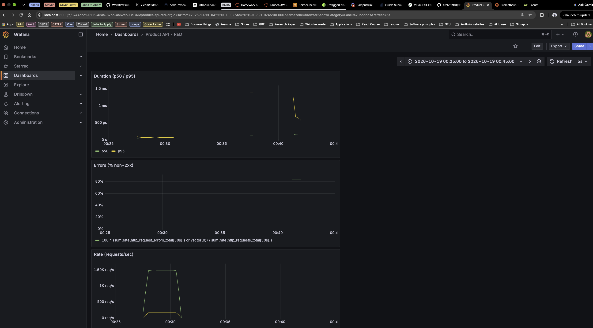

Locust's stats for the same local run:

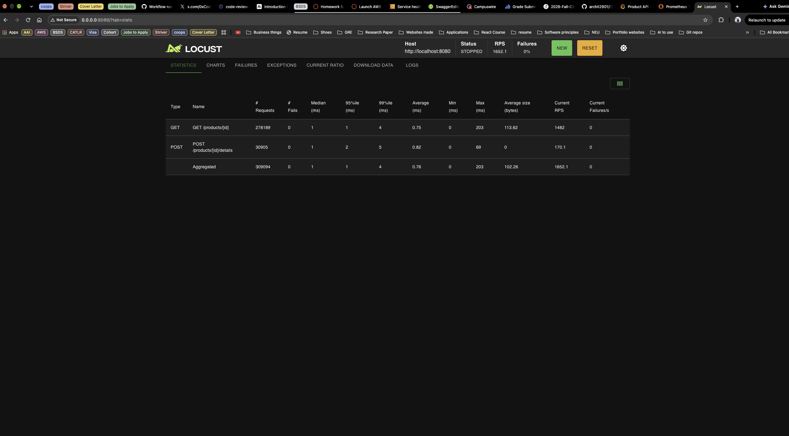

### Log excerpt from the same run

The full excerpt is in `observability/log-excerpt.txt`. The first three lines are from the Locust load and the rest are from the Postman burst:

```json
{"time":"2026-10-19T04:29:03.062562196Z","level":"INFO","msg":"request","method":"POST","endpoint":"/products/:productId/details","path":"/products/17/details","status":204,"duration_ms":0.04}
{"time":"2026-10-19T04:29:03.06271807Z","level":"INFO","msg":"request","method":"GET","endpoint":"/products/:productId","path":"/products/54","status":200,"duration_ms":0.003}
{"time":"2026-10-19T04:29:03.063174359Z","level":"INFO","msg":"request","method":"GET","endpoint":"/products/:productId","path":"/products/4","status":200,"duration_ms":0.002}
{"time":"2026-10-19T04:41:36.089139971Z","level":"INFO","msg":"request","method":"POST","endpoint":"/products/:productId/details","path":"/products/1/details","status":400,"duration_ms":0.107}
{"time":"2026-10-19T04:41:36.107067023Z","level":"INFO","msg":"request","method":"POST","endpoint":"/products/:productId/details","path":"/products/abc/details","status":400,"duration_ms":0.026}
{"time":"2026-10-19T04:41:36.115302554Z","level":"INFO","msg":"request","method":"POST","endpoint":"/products/:productId/details","path":"/products/999/details","status":404,"duration_ms":0.102}
{"time":"2026-10-19T04:41:36.131819781Z","level":"INFO","msg":"request","method":"POST","endpoint":"/products/:productId/details","path":"/products/1/details","status":500,"duration_ms":0.312}
```

One thing I noticed: the logs show a normal GET taking about 2 to 3 microseconds, while the dashboard's p50 says around 30. Both are fine. The logs record each request's exact time, while the histogram only knows which bucket a request fell into (my smallest bucket is 0 to 50 microseconds), so Grafana has to estimate.

### When I'd use the dashboard vs. the logs

I'd look at the dashboard first to find out whether something is wrong and how bad it is. During my run, it showed the traffic jump and the error rate spike to 83% without me reading a single log line. Then I'd go to the logs to find out which requests failed and why, because each line has the exact path, status and time, like the `/products/999/details` 404 or the 500 that took 0.31 ms when a normal GET takes about 0.003 ms.
